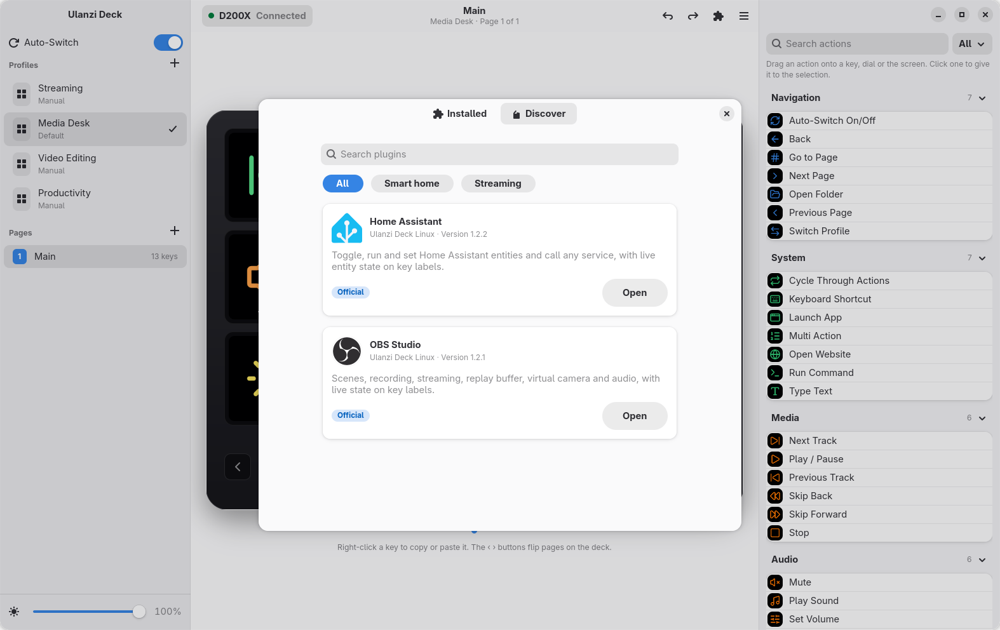

<div align="center">


# Ulanzi Deck

A Linux app for the Ulanzi D200 and D200X stream decks: assign actions to keys and dials, show
widgets on the wide screen, and switch profiles with the app in focus.

[](https://github.com/Tyaaa-aa/Ulanzi-Deck-Linux/releases/latest)
[](https://github.com/Tyaaa-aa/Ulanzi-Deck-Linux/actions/workflows/ci.yml)
[](LICENSE)


[**Download**](https://github.com/Tyaaa-aa/Ulanzi-Deck-Linux/releases/latest) ·
[User guide](docs/user-guide.md) ·
[Troubleshooting](docs/troubleshooting.md) ·
[Technical guide](docs/technical.md) ·
[Report a problem](https://github.com/Tyaaa-aa/Ulanzi-Deck-Linux/issues/new/choose)

<br>

<picture>
  <source media="(prefers-color-scheme: dark)" srcset="docs/screenshots/main-dark.png">
  
</picture>

</div>

## Features

- All 13 keys, the 3 dials, the 2 small buttons and the wide screen, each with a press and a hold
  action. Edits are sent to the deck immediately.
- Actions for media playback and seeking, volume per output, app or microphone, output switching,
  keyboard shortcuts, typing text, running commands, opening apps and websites, playing sounds,
  multi-step sequences, and keys that cycle through several actions.
- Wide-screen widgets: clocks, system graphs, Now Playing, a Pomodoro timer, weather, command output,
  images and OBS status, plus a volume bar while you change the volume.
- Profiles that switch with the focused app on KDE Plasma, GNOME, Hyprland, Sway and X11.
- A plugin store with signed, sandboxed plugins, starting with OBS Studio and Home Assistant. Plugin
  keys show live state, such as the scene on air, recording time, or whether a light is on.
- Templates, `.ulanzideck` files for sharing setups, and daily automatic backups.
- A background service and tray icon, so the deck keeps working with the window closed.

## Screenshots

<table>
  <tr>
    <td></td>
    <td></td>
  </tr>
  <tr>
    <td align="center"><sub>Wide-screen widgets with a live preview</sub></td>
    <td align="center"><sub>Key editor</sub></td>
  </tr>
  <tr>
    <td></td>
    <td></td>
  </tr>
  <tr>
    <td align="center"><sub>Plugin store</sub></td>
    <td align="center"><sub>Templates</sub></td>
  </tr>
</table>

<p align="center">
  
</p>

## Install

Download the package for your distribution from the
[latest release](https://github.com/Tyaaa-aa/Ulanzi-Deck-Linux/releases/latest). Ulanzi Deck requires
GTK 4.16 and libadwaita 1.6 or newer, which ship with Arch and its derivatives, Fedora 41 and later,
Ubuntu 25.04 and later, Debian 13 and openSUSE Tumbleweed.

| Distribution | File | Command |
|---|---|---|
| Arch, CachyOS, EndeavourOS, Manjaro | `ulanzi-deck-*.pkg.tar.zst` | `sudo pacman -U ulanzi-deck-*.pkg.tar.zst` |
| Debian, Ubuntu, Mint, Pop!_OS | `ulanzi-deck_*.deb` | `sudo apt install ./ulanzi-deck_*.deb` |
| Fedora, openSUSE | `ulanzi-deck-*.rpm` | `sudo dnf install ./ulanzi-deck-*.rpm` |
| Any (portable) | `Ulanzi_Deck-*.AppImage` | `chmod +x Ulanzi_Deck-*.AppImage`, then run it. `--install` adds a menu entry. |
| Any | `ulanzi-deck-*-x86_64.tar.gz` | Extract, then run `./install.sh` (current user) or `./install.sh --system` |

On first launch, the setup assistant detects the deck, requests USB access, offers to import a
version 1 configuration, and starts the background service. With the .deb, .rpm and Arch packages,
you can also enable the service yourself:

```sh
systemctl --user enable --now ulanzi-deckd
```

To build from source, see [Building](docs/technical.md#building) in the technical guide.

## Documentation

- [User guide](docs/user-guide.md): keys, actions, dials, widgets, profiles, plugins and backups
- [Troubleshooting](docs/troubleshooting.md): device detection, OBS, profile switching and more
- [Technical guide](docs/technical.md): architecture, file formats, D-Bus API, CLI, building and packaging
- [Writing plugins](docs/plugins.md): the plugin contract, manifest, permissions and an example
- [Hardware notes](docs/hardware-notes.md): the USB protocol, as measured on the device
- [Release testing](TESTING.md): the manual checklist used before each release

## Templates

Right-click a profile and choose **Save as Template** to turn it into a template. Templates are
`.ulanzideck` files and can be shared like any other file. Share yours in
[Discussions](https://github.com/Tyaaa-aa/Ulanzi-Deck-Linux/discussions).

## Plugins

Plugins are installed from the store in the app's Plugins window. They live in a separate repository,
[Ulanzi-Deck-Plugins](https://github.com/Tyaaa-aa/Ulanzi-Deck-Plugins), where new plugins can be
submitted as pull requests. See [Writing plugins](docs/plugins.md) to build one.

## Command line

`ulanzictl` controls the service from a terminal. Its commands include `status`, `profile`, `page`,
`brightness`, `plugin`, `import`, `export`, `snapshots`, `restore`, `validate`, `monitor` (prints
input events as they happen) and `diagnostics` (collects the details a bug report needs).

## Contributing

Bug reports, feature requests, templates and pull requests are welcome. See
[CONTRIBUTING.md](CONTRIBUTING.md). To report a security issue, follow [SECURITY.md](SECURITY.md).

## Credits

- The USB protocol work builds on [racerxdl/ulanzi-d200-linux](https://github.com/racerxdl/ulanzi-d200-linux),
  [mariovalney/ulanzi-d200-linux](https://github.com/mariovalney/ulanzi-d200-linux) and
  [fkras/homedeck](https://github.com/fkras/homedeck).
- Icons: [Lucide](https://lucide.dev) (ISC). Brand logos: [Simple Icons](https://simpleicons.org) (CC0);
  brand names and logos are trademarks of their owners. Weather: [Open-Meteo](https://open-meteo.com).
- Version 1, written in Python, is on the [`python-legacy`](https://github.com/Tyaaa-aa/Ulanzi-Deck-Linux/tree/python-legacy) branch.

<sub>Ulanzi Deck is an independent project and is not affiliated with Ulanzi. [MIT License](LICENSE) · [Changelog](CHANGELOG.md)</sub>
