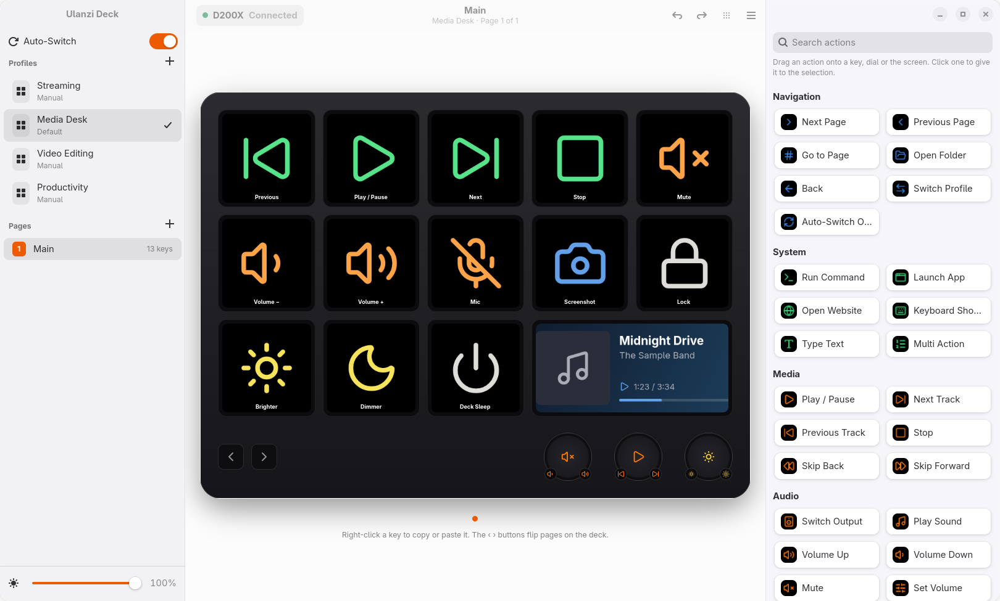
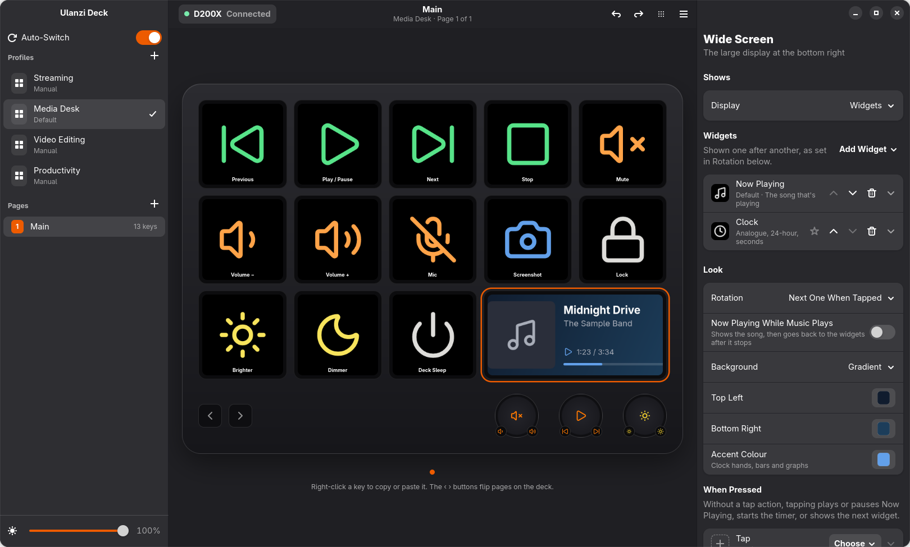
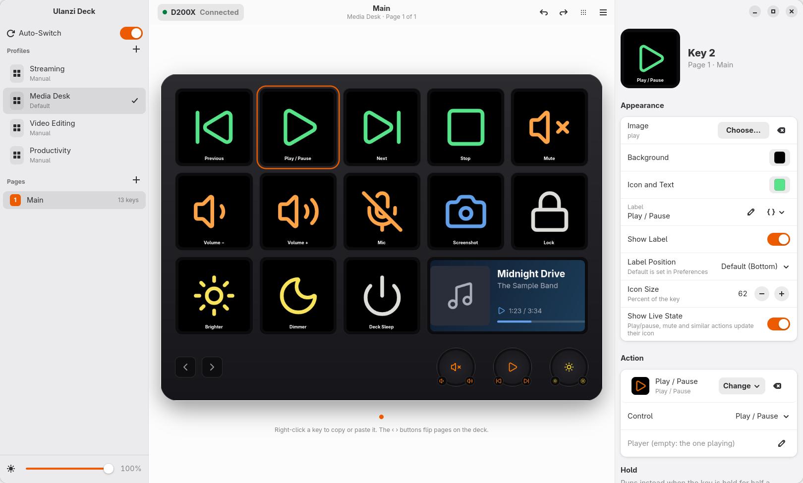
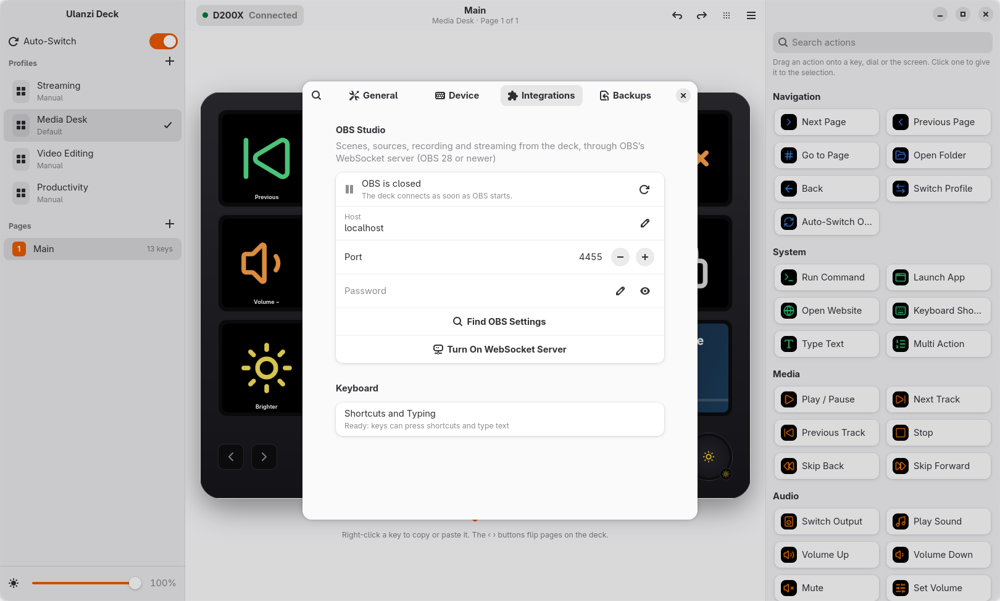
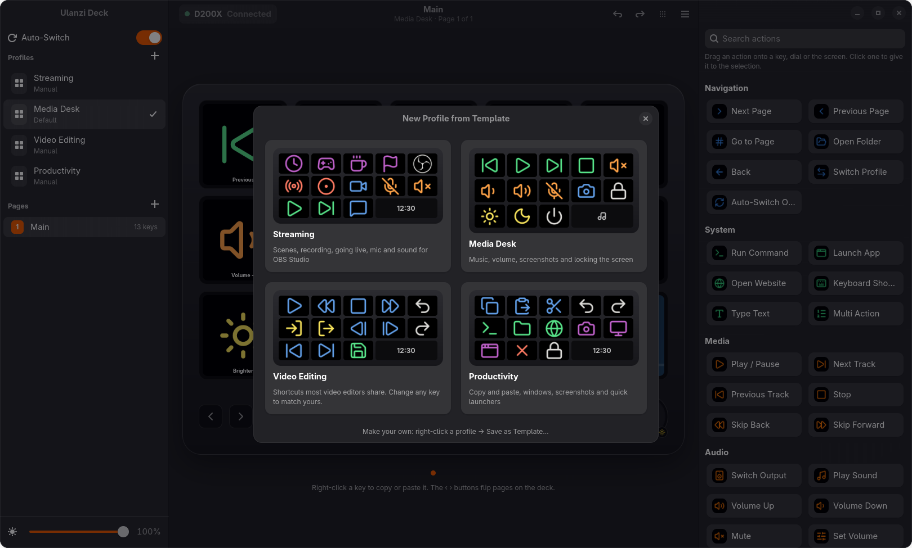
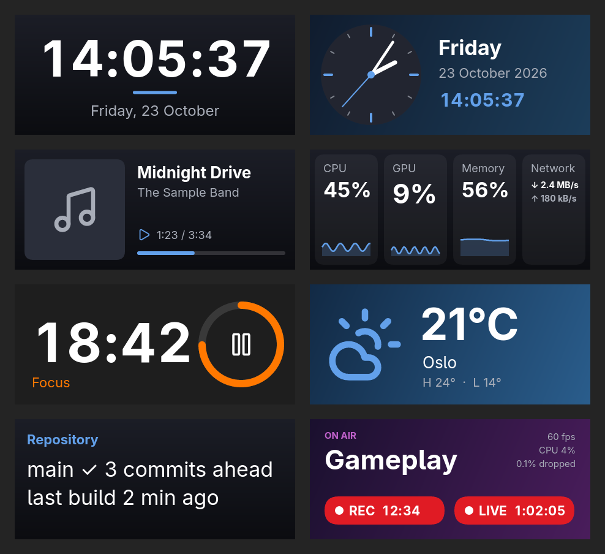

<div align="center">


# Ulanzi Deck

**Set up the Ulanzi D200 and D200X stream decks on Linux.**

Drag actions onto keys, put live widgets on the wide screen, control OBS Studio,
and let your profiles follow the app you're using.

[](https://github.com/Tyaaa-aa/Ulanzi-Deck-Linux/releases/latest)
[](https://github.com/Tyaaa-aa/Ulanzi-Deck-Linux/actions/workflows/ci.yml)
[](LICENSE)


[**Download**](https://github.com/Tyaaa-aa/Ulanzi-Deck-Linux/releases/latest) ·
[User guide](docs/user-guide.md) ·
[Troubleshooting](docs/troubleshooting.md) ·
[Technical guide](docs/technical.md) ·
[Report a problem](https://github.com/Tyaaa-aa/Ulanzi-Deck-Linux/issues/new/choose)

<br>

<picture>
  <source media="(prefers-color-scheme: dark)" srcset="docs/screenshots/main-dark.png">
  
</picture>

</div>

## Highlights

<table>
<tr>
<td width="50%" valign="top">

**🎛️ Every control, live**
13 keys, 3 dials, 2 small buttons and the wide screen, each with a tap and a hold action.
Changes reach the deck as you make them.

**⚡ Plenty of actions**
Media and seeking, volume for any output, app or microphone, output switching, shortcuts,
typing, commands, apps, websites, sounds and multi-step actions.

**🎬 OBS Studio**
Scenes, sources, filters, audio, recording, streaming, replay buffer and virtual camera.
Keys show what's on air, with REC and LIVE times.

</td>
<td width="50%" valign="top">

**🖥️ A living wide screen**
Clocks, system graphs, Now Playing, a Pomodoro timer, weather, command output, pictures and
OBS status, with a volume bar when you turn the volume.

**🔀 Profiles that follow you**
Your editing keys appear when the editor is in front, your streaming keys when OBS is
(KDE Plasma, GNOME, Hyprland, Sway, X11).

**🧩 Share and keep**
Templates, `.ulanzideck` files to share setups, and automatic daily backups.
A tray icon and a background service keep the deck working with the window closed.

</td>
</tr>
</table>

<table>
  <tr>
    <td></td>
    <td></td>
  </tr>
  <tr>
    <td align="center"><sub>Widgets for the wide screen, previewed live</sub></td>
    <td align="center"><sub>Tap and hold actions, look and live state</sub></td>
  </tr>
  <tr>
    <td></td>
    <td></td>
  </tr>
  <tr>
    <td align="center"><sub>OBS: every connection problem explained, one-click setup</sub></td>
    <td align="center"><sub>Start from a template, or save your own</sub></td>
  </tr>
</table>

<p align="center">
  
</p>

## Install

Get the file for your system from the [latest release](https://github.com/Tyaaa-aa/Ulanzi-Deck-Linux/releases/latest).
Ulanzi Deck needs **GTK 4.16** and **libadwaita 1.6** or newer: Arch and its derivatives, Fedora 41+,
Ubuntu 25.04+, Debian 13, openSUSE Tumbleweed.

| Your system | Download | Install with |
|---|---|---|
| **Arch**, CachyOS, EndeavourOS, Manjaro | `ulanzi-deck-*.pkg.tar.zst` | `sudo pacman -U ulanzi-deck-*.pkg.tar.zst` |
| **Debian**, **Ubuntu**, Mint, Pop!_OS | `ulanzi-deck_*.deb` | `sudo apt install ./ulanzi-deck_*.deb` |
| **Fedora**, openSUSE | `ulanzi-deck-*.rpm` | `sudo dnf install ./ulanzi-deck-*.rpm` |
| **Any system**, no install | `Ulanzi_Deck-*.AppImage` | `chmod +x Ulanzi_Deck-*.AppImage`, run it; `--install` adds it to the menu |
| **Any system** | `ulanzi-deck-*-x86_64.tar.gz` | unpack, then `./install.sh` (just you) or `./install.sh --system` |

Then open **Ulanzi Deck** from your app menu. A short setup finds the deck, asks once for permission
to use it, can bring over your setup from version 1, and starts the background service.
After installing a `.deb`, `.rpm` or Arch package, start the service for your user once
(the setup offers it too):

```sh
systemctl --user enable --now ulanzi-deckd
```

Building it yourself is a `cargo build --release` away; see the [technical guide](docs/technical.md#building).

## Documentation

| | |
|---|---|
| 📘 [**User guide**](docs/user-guide.md) | Everything in the app, step by step: keys, actions, dials, widgets, profiles, OBS, backups |
| 🩺 [**Troubleshooting**](docs/troubleshooting.md) | The deck isn't found, OBS won't connect, auto-switch, and more |
| 🛠️ [**Technical guide**](docs/technical.md) | Architecture, files on disk, profile format, D-Bus API, CLI, building, testing, packaging |
| 🔌 [**Hardware notes**](docs/hardware-notes.md) | The deck's USB protocol, measured on real hardware |
| 🧪 [**Testing before a release**](TESTING.md) | The hands-on checklist |

## Templates

Any profile can become a template: right-click it → **Save as Template…**. Templates are plain
`.ulanzideck` files, so a layout for your editor, design tool, DAW or game is easy to keep and to
share. Show yours in [Discussions](https://github.com/Tyaaa-aa/Ulanzi-Deck-Linux/discussions).

## Command line

`ulanzictl` drives the service: `status`, `profile`, `page`, `brightness`, `import`, `export`,
`snapshots`, `restore`, `validate`, `monitor` (presses as they happen) and `diagnostics`
(everything a bug report needs).

## Contributing

Bug reports, ideas, templates and code are welcome. [CONTRIBUTING.md](CONTRIBUTING.md) explains how
to report a problem well and how to send a change. Found a security problem? See [SECURITY.md](SECURITY.md).

## Credits

- The USB protocol builds on the research in [racerxdl/ulanzi-d200-linux](https://github.com/racerxdl/ulanzi-d200-linux),
  [mariovalney/ulanzi-d200-linux](https://github.com/mariovalney/ulanzi-d200-linux) and
  [fkras/homedeck](https://github.com/fkras/homedeck).
- Icons: [Lucide](https://lucide.dev) (ISC). Brand logos: [Simple Icons](https://simpleicons.org) (CC0);
  brand names and logos are trademarks of their owners. Weather: [Open-Meteo](https://open-meteo.com).
- Version 1 (Python) lives on the [`python-legacy`](https://github.com/Tyaaa-aa/Ulanzi-Deck-Linux/tree/python-legacy) branch.

<sub>Ulanzi Deck is an independent project, not affiliated with Ulanzi. [MIT License](LICENSE) · [Changelog](CHANGELOG.md)</sub>
