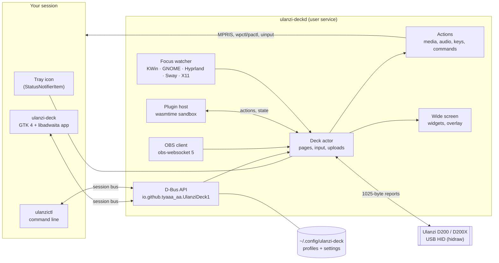

# Technical guide

How Ulanzi Deck is put together, where it keeps things, and how to build, test and package it.
For using the app, see the [user guide](user-guide.md).

**Contents**
[Architecture](#architecture) ·
[Crates](#crates) ·
[Files on disk](#files-on-disk) ·
[Profile format](#profile-format) ·
[D-Bus API](#d-bus-api) ·
[Plugins](#plugins) ·
[Command line](#command-line) ·
[Environment variables](#environment-variables) ·
[Logs](#logs) ·
[Building](#building) ·
[Testing](#testing) ·
[Packaging and releases](#packaging-and-releases) ·
[The deck's protocol](#the-decks-protocol)

---

## Architecture



- **`ulanzi-deckd`** is the only program that talks to the deck. It runs as a systemd user service
  (D-Bus activated on demand), so keys work with the window closed.
- **The deck actor** owns the connection: it turns key/dial reports into actions, draws keys and the
  wide screen, and uploads only what changed (partial updates, at most one upload per 500 ms).
- **The app** is a client: it edits a profile locally (with undo) and sends it with `ApplyProfile`.
  A revision number per profile stops two clients from overwriting each other.
- Everything that can run without I/O (protocol, rendering, models, matching, OBS messages) is pure
  code with unit tests; I/O sits at the edges.

## Crates

| Crate | Kind | Responsibility |
|---|---|---|
| `ulanzi-proto` | lib | The deck's USB protocol: report framing, commands, input parsing, the ZIP the deck expects |
| `ulanzi-core` | lib | Profile and settings model, storage, key and wide-screen rendering, icons, catalog of actions, bundles, templates, backups, migration from version 1 |
| `ulanzi-plugin` | lib | The plugin SDK and the contract (`wit/plugin.wit`, package `ulanzi:plugin@1.1.0`); plugins build to WebAssembly, and a test harness runs them natively |
| `ulanzi-deckd` | bin + lib | The service: device I/O and hot-plug, deck actor, actions, OBS client, plugin host, widgets data, focus tracking, tray, D-Bus API |
| `ulanzictl` | bin | Command-line client (including `plugin`), plus `probe` for talking to the deck directly |
| `ulanzi-deck` | bin + lib | The GTK app |

Rust edition 2024, toolchain pinned in `rust-toolchain.toml`. Examples live in `examples/plugins/`
(`hello`). Main dependencies: gtk4-rs/libadwaita,
zbus (D-Bus), tokio, wasmtime (plugins), oo7 (plugin secrets), resvg/tiny-skia and cosmic-text (drawing), tokio-tungstenite (OBS), ureq (weather,
album art), ksni (tray), x11rb (X11 focus), evdev (virtual keyboard).

## Files on disk

| Path | What |
|---|---|
| `~/.config/ulanzi-deck/settings.toml` | Settings (mode 0600: it can hold the OBS password) |
| `~/.config/ulanzi-deck/profiles/<uuid>/profile.toml` | One profile |
| `~/.config/ulanzi-deck/profiles/<uuid>/icons/` | Pictures used by that profile |
| `~/.local/state/ulanzi-deck/snapshots/` | Backups (`YYYYmmdd-HHMMSS-NNN-reason.ulanzideck`, newest 20 kept) |
| `~/.local/state/ulanzi-deck/onboarded` | Set when the first-run setup was finished |
| `~/.local/state/ulanzi-deck/kwin-focus.js` | The KWin script used for auto-switch on Plasma |
| `~/.config/ulanzi-deck/plugin-secrets.toml` | Plugin secrets when no system keyring answers (mode 0600) |
| `~/.local/share/ulanzi-deck/plugins/<id>/` | An installed plugin: `plugin.toml`, `plugin.wasm`, optional `assets/` |
| `~/.cache/ulanzi-deck/plugins/` | Compiled plugins (safe to delete) |
| `~/.cache/ulanzi-deck/art/` | Album art (downloaded or copied from players; newest 100 kept) |
| `~/.local/share/ulanzi-deck/templates/` | Your own templates (`.ulanzideck`) |
| `/etc/udev/rules.d/70-ulanzi-deck.rules` (or `/usr/lib/udev/rules.d/`) | Lets the logged-in user open the deck and `/dev/uinput` |

All paths follow `XDG_CONFIG_HOME`, `XDG_STATE_HOME`, `XDG_CACHE_HOME` and `XDG_DATA_HOME`.
A profile file that doesn't parse is moved aside as `profile.toml.invalid-<time>` and reported, never
silently dropped.

A **`.ulanzideck` bundle** is a ZIP with `manifest.toml`, optionally `settings.toml` (never with the
OBS password) and `profiles/<uuid>/{profile.toml, icons/…}`. Imports check every path, cap the total
size at 50 MB and decode every image before accepting it.

## Profile format

A shortened `profile.toml`:

```toml
version = 1
id = "5a6bf8b2-cfa3-4a80-a8fc-f365e7234fd8"
name = "Media Desk"
model = "D200X"

[match]                      # auto-switch: this profile follows these apps
apps = ["org.kde.kdenlive.desktop"]

[screen]
mode = "custom"              # or "firmware_clock" / "firmware_stats"
rotate = { kind = "on_press" }
accent = "#62a0ea"
media = { on = true, back_after_s = 10 }
widgets = [
  { kind = "now_playing", progress = true },
  { kind = "clock", face = "analog", seconds = true },
]

[[pages]]
id = "…"
name = "Main"

[pages.keys.1.look]
source = { kind = "icon", set = "lucide", name = "play" }
background = "#000000"
foreground = "#57e389"
label = { text = "Play / Pause", visible = true }

[pages.keys.1.tap]
type = "media"
control = "play_pause"
```

`ulanzictl validate [file]` checks profile files and prints what is wrong, with line numbers.

## D-Bus API

Bus name `io.github.tyaaa_aa.UlanziDeck.Service`, object `/io/github/tyaaa_aa/UlanziDeck`,
interface `io.github.tyaaa_aa.UlanziDeck1` (API version 1). Explore it with
`busctl --user introspect io.github.tyaaa_aa.UlanziDeck.Service /io/github/tyaaa_aa/UlanziDeck`.

| Group | Methods |
|---|---|
| State | `Hello`, `Firmware`, `ListProfiles`, `GetProfile`, `ApplyProfile` (with revision), `ProfileRevision`, `CreateProfile`, `DeleteProfile`, `SwitchProfile`, `SetPage`, `NextPage`, `PrevPage`, `SetBrightness`, `Reload` |
| Settings | `GetSettings`, `ApplySettings` (TOML; the OBS password is never sent back, a placeholder keeps it) |
| Sharing and backups | `PreviewBundle`, `BundleCommands`, `ImportBundle`, `ExportBundle`, `ListSnapshots`, `TakeSnapshot`, `RestoreSnapshot`, `Migrate` |
| Auto-switch | `WindowActivated` (used by the KWin script and GNOME extension), `FocusedWindow`, `FocusStatus` |
| OBS | `ObsStatus`, `ObsList`, `ObsUseDetected`, `ObsEnableServer`, `ObsReconnect` |
| Widgets | `NowPlaying`, `WeatherPlaces`, `WeatherNow` |
| Plugins | `PluginList` (id, name, version, status, detail), `PluginInstallDir` (an absolute path; needs Developer mode), `PluginRemove`, `PluginSetEnabled`, `PluginRestart`, `PluginManifests` (JSON `{id: Manifest}`), `PluginInspectDir` (absolute path; JSON `Inspected`; works without Developer mode), `PluginListItems` (id, picker, query, group; JSON array of `PickItem`; starts the plugin if needed; NotFound for an unknown plugin, Invalid for an undeclared picker, Unavailable with the plugin's own message), `PluginSecretKeys` (which declared secrets are set), `PluginSetSecret` / `PluginClearSecret` (write-only: also remove the key from `[plugins.<id>.settings]`). `GetSettings` shows every secret-kind plugin setting as `••••`; `ApplySettings` keeps the stored value for it, or drops the key when the secret has moved to the store |

Signals: `DeviceStateChanged`, `PageChanged`, `InputEvent`, `ProfilesChanged`, `SettingsChanged`,
`ActionFailed`, `ObsStatusChanged`, `PluginsChanged`.

## Plugins

Plugins are WebAssembly components run by wasmtime inside `ulanzi-deckd`, one instance each, with
64 MiB of memory, 500 ms per call and no access to files or sockets except through the host, which
checks every connection against the plugin's permissions. A crash restarts the plugin once; a second
one within 5 minutes leaves it `failed`. The deck starts first; the plugins are loaded and compiled
in the background (a plugin key pressed meanwhile reports "plugins are still starting", and the D-Bus
plugin methods "plugins are not running yet"), and the keyring is asked only when a plugin first needs
its secrets. The contract, permissions and limits are in the
[plugin guide](plugins.md). Each plugin has `[plugins.<id>]` in `settings.toml` (`enabled`, plus a `[plugins.<id>.settings]` subtable passed to the plugin); a plugin's state
reaches key labels as `{<id>.<key>}`.

## Command line

```text
ulanzictl status                 device and service state
ulanzictl profile list|switch    list or switch profiles
ulanzictl page next|prev|<n>     change page
ulanzictl brightness <0-100>
ulanzictl export <file> [--profile <name>]   ulanzictl import <file> [--skip|--replace]
ulanzictl snapshots              ulanzictl restore <name>
ulanzictl validate [file]        check profile files
ulanzictl plugin list|install|remove|enable|disable|restart|dev-mode on|off|items <id> <picker>
ulanzictl monitor                print presses, page changes and action errors live
ulanzictl diagnostics            versions, session, device and recent logs (for bug reports)
ulanzictl migrate                import version 1's ~/.config/ulanzi/config.yaml
ulanzictl probe …                talk to the deck directly (stop the service first)
```

## Environment variables

| Variable | Effect |
|---|---|
| `ULANZI_LOG` | Log filter for the service, e.g. `debug` or `ulanzi_deckd::obs=debug` |
| `ULANZI_DEMO=1` | The service uses a pretend deck: nothing touches the hardware (screenshots, tests) |
| `ULANZI_OBS_CONFIG_HOME` | Where to read OBS's settings when it differs from `XDG_CONFIG_HOME` (the sandbox uses it) |
| `ULANZI_BIN` | `scripts/sandbox.sh`: which folder's binaries to run |

## Logs

- Under systemd: `journalctl --user -u ulanzi-deckd -f`
- Started by hand: a daily file in `~/.local/state/ulanzi-deck/` (`daemon.*.log`, three kept)
- `ULANZI_LOG=debug systemctl --user restart ulanzi-deckd` is not enough (systemd drops the
  variable); use `systemctl --user edit ulanzi-deckd` and add `Environment=ULANZI_LOG=debug`.

## Building

Requirements: Rust (the version in `rust-toolchain.toml`, installed automatically by rustup), GTK 4.16+
and libadwaita 1.6+ development files, pkg-config.

```sh
# Arch:   sudo pacman -S --needed gtk4 libadwaita pkgconf
# Fedora: sudo dnf install gtk4-devel libadwaita-devel
# Debian/Ubuntu: sudo apt install libgtk-4-dev libadwaita-1-dev pkg-config
cargo build --release
scripts/dev-install.sh       # install into ~/.local (binaries, unit, D-Bus file, menu entry)
scripts/dev-uninstall.sh
```

## Testing

```sh
scripts/test.sh            # format, clippy (warnings are errors), every test, file validation,
                           # and an end-to-end run of the service, CLI and app on a private bus
scripts/test.sh --quick    # without the end-to-end part
scripts/sandbox.sh --demo  # the app with a pretend deck and throwaway profiles
scripts/sandbox.sh --showcase   # the real deck on throwaway profiles (your service pauses)
```

Tests never touch your configuration. The OBS client is tested against a mock obs-websocket server
covering every connection state; the deck actor against a mock transport with a paused clock.
[TESTING.md](../TESTING.md) is the hands-on checklist before a release.

## Packaging and releases

| Script | Does |
|---|---|
| `scripts/stage.sh PREFIX DESTDIR` | Lays out the installed tree for any prefix (used by every package) |
| `scripts/release.sh` | Builds the tarball (with `install.sh`/`uninstall.sh`), `.deb`, `.rpm`, Arch package (`PKGBUILD` + `.SRCINFO`), AppImage, source tarball and `SHA256SUMS` into `dist/` |
| `scripts/publish.sh` | Dry run by default; `--go` pushes, tags `v<version>` and creates the GitHub release |
| `scripts/screenshots.sh` | README screenshots from the showcase profiles in a sandbox |

Packaging files: `packaging/systemd` (user unit, `@BINDIR@` filled in at install),
`packaging/dbus` (activation file), `packaging/udev`, `packaging/arch/PKGBUILD`,
`packaging/appimage/AppRun` (`--install`, `--service`, `--ctl`), `packaging/tarball`,
`packaging/gnome-extension`. The `.deb` and `.rpm` metadata live in `crates/ulanzi-deck/Cargo.toml`
(cargo-deb, cargo-generate-rpm).

## The deck's protocol

[hardware-notes.md](hardware-notes.md) has everything measured on real hardware: input indices,
the upload format, partial updates, locking and the keep-alive.
