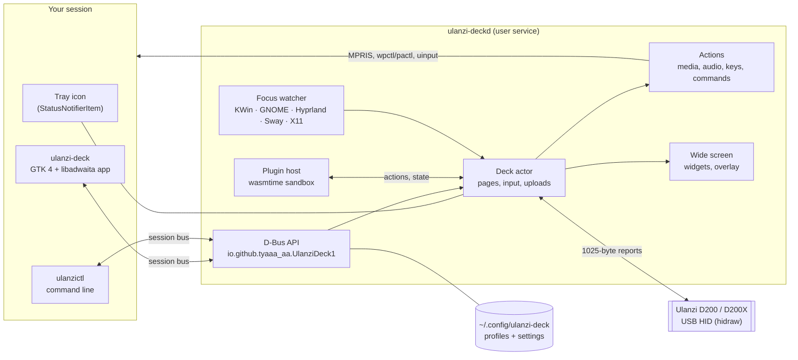

# Technical guide

This document covers the architecture of Ulanzi Deck, where it stores data, its D-Bus API, and how
to build, test and package it. For end-user documentation, see the [user guide](user-guide.md).

## Contents

- [Architecture](#architecture)
- [Crates](#crates)
- [Files on disk](#files-on-disk)
- [Profile format](#profile-format)
- [D-Bus API](#d-bus-api)
- [Plugins](#plugins)
- [Command line](#command-line)
- [Environment variables](#environment-variables)
- [Logs](#logs)
- [Building](#building)
- [Testing](#testing)
- [Packaging and releases](#packaging-and-releases)
- [Device protocol](#device-protocol)

## Architecture



- `ulanzi-deckd` is the only process that communicates with the deck. It runs as a systemd user
  service (also D-Bus activated), so keys work while the window is closed.
- The deck actor owns the device connection. It maps key and dial reports to actions, renders keys
  and the wide screen, and uploads only what changed (partial updates, at most one upload every
  500 ms).
- The GUI is a client. It edits a profile locally, with undo, and sends it with `ApplyProfile`. A
  per-profile revision number prevents concurrent clients from overwriting each other.
- Logic that does not need I/O (protocol, rendering, data model, window matching, file upgrades) is
  kept free of side effects and unit tested; I/O is confined to the edges.

## Crates

| Crate | Kind | Responsibility |
|---|---|---|
| `ulanzi-proto` | lib | The deck's USB protocol: report framing, commands, input parsing, the ZIP the deck expects |
| `ulanzi-core` | lib | Profile and settings model, storage, key and wide-screen rendering, icons, action catalog, bundles, templates, backups, file format upgrades, migration from version 1, plugin manifests and store index |
| `ulanzi-plugin` | lib | Plugin SDK and contract (`wit/plugin.wit`, package `ulanzi:plugin@1.1.0`). Plugins compile to WebAssembly; a test harness runs them natively |
| `ulanzi-deckd` | bin + lib | The service: device I/O and hot-plug, deck actor, actions, plugin host and store client, widget data, focus tracking, tray, D-Bus API |
| `ulanzictl` | bin | Command-line client, including plugin management and `probe` for direct device access |
| `ulanzi-deck` | bin + lib | The GTK app |

The workspace uses Rust edition 2024, with the toolchain pinned in `rust-toolchain.toml`. The example
plugin is in `examples/plugins/hello`. Main dependencies: gtk4-rs and libadwaita, zbus (D-Bus),
tokio, wasmtime (plugin host), oo7 (plugin secrets), minisign-verify and sha2 (plugin signatures),
resvg, tiny-skia and cosmic-text (rendering), tokio-tungstenite (plugin WebSockets), ureq (weather,
album art, plugin store), ksni (tray), x11rb (X11 focus) and evdev (virtual keyboard).

## Files on disk

| Path | What |
|---|---|
| `~/.config/ulanzi-deck/settings.toml` | Settings (mode 0600). Plugin passwords found here are moved to the plugin's secret store |
| `~/.config/ulanzi-deck/before-2.1/` | Copies of 2.0 configuration files, made once before they are upgraded to file format 2 |
| `~/.config/ulanzi-deck/profiles/<uuid>/profile.toml` | One profile |
| `~/.config/ulanzi-deck/profiles/<uuid>/icons/` | Pictures used by that profile |
| `~/.local/state/ulanzi-deck/snapshots/` | Backups (`YYYYmmdd-HHMMSS-NNN-reason.ulanzideck`, newest 20 kept) |
| `~/.local/state/ulanzi-deck/updates.toml` | Update check state: whether to check, the last check, the release on offer, the skipped version |
| `~/.local/state/ulanzi-deck/onboarded` | Created when first-run setup completes |
| `~/.local/state/ulanzi-deck/kwin-focus.js` | The KWin script used for auto-switch on Plasma |
| `~/.config/ulanzi-deck/plugin-secrets.toml` | Plugin secrets when no system keyring answers (mode 0600) |
| `~/.local/share/ulanzi-deck/plugins/<id>/` | An installed plugin: `plugin.toml`, `plugin.wasm`, optional `assets/`, and a `.verified` marker for signed installs |
| `~/.local/share/ulanzi-deck/plugins/.store-index.json`, `.store-icons/` | Cached plugin store index (with its signature) and icons |
| `~/.cache/ulanzi-deck/plugins/` | Compiled plugins (safe to delete) |
| `~/.cache/ulanzi-deck/updates/` | Downloaded updates (safe to delete) |
| `~/.cache/ulanzi-deck/art/` | Album art (downloaded or copied from players; newest 100 kept) |
| `~/.local/share/ulanzi-deck/templates/` | User templates (`.ulanzideck`) |
| `/etc/udev/rules.d/70-ulanzi-deck.rules` (or `/usr/lib/udev/rules.d/`) | Grants the logged-in user access to the deck and `/dev/uinput` |

All paths follow `XDG_CONFIG_HOME`, `XDG_STATE_HOME`, `XDG_CACHE_HOME` and `XDG_DATA_HOME`.
A profile file that fails to parse is renamed to `profile.toml.invalid-<time>` and reported; it is
never discarded silently.

A `.ulanzideck` bundle is a ZIP archive containing `manifest.toml`, optionally `settings.toml`
(without plugin secrets), and `profiles/<uuid>/{profile.toml, icons/…}`. Imports validate every
path, limit the total size to 50 MB and decode every image before accepting it.

## Profile format

An abbreviated `profile.toml`:

```toml
version = 2
id = "5a6bf8b2-cfa3-4a80-a8fc-f365e7234fd8"
name = "Media Desk"
model = "D200X"

[match]                      # auto-switch: this profile follows these apps
apps = ["org.kde.kdenlive.desktop"]

[screen]
mode = "custom"              # or "firmware_clock" / "firmware_stats"
rotate = { kind = "on_press" }
accent = "#62a0ea"
media = { on = true, back_after_s = 10 }
widgets = [
  { kind = "now_playing", progress = true },
  { kind = "clock", face = "analog", seconds = true },
]

[[pages]]
id = "…"
name = "Main"

[pages.keys.1.look]
source = { kind = "icon", set = "lucide", name = "play" }
background = "#000000"
foreground = "#57e389"
label = { text = "Play / Pause", visible = true }

[pages.keys.1.tap]
type = "media"
control = "play_pause"
```

`ulanzictl validate [file]` checks profile files and reports errors with line numbers.

Files written by Ulanzi Deck 2.0 (format version 1) are upgraded when read: built-in OBS actions
become `plugin = "obs"` actions, and the `[obs]` settings table moves to `[plugins.obs.settings]`.

## D-Bus API

Bus name `io.github.tyaaa_aa.UlanziDeck.Service`, object `/io/github/tyaaa_aa/UlanziDeck`,
interface `io.github.tyaaa_aa.UlanziDeck1` (API version 1). To inspect it, run
`busctl --user introspect io.github.tyaaa_aa.UlanziDeck.Service /io/github/tyaaa_aa/UlanziDeck`.

| Group | Methods |
|---|---|
| State | `Hello`, `Firmware`, `ListProfiles`, `GetProfile`, `ApplyProfile` (with revision), `ProfileRevision`, `CreateProfile`, `DeleteProfile`, `SwitchProfile`, `SetPage`, `NextPage`, `PrevPage`, `SetBrightness`, `Reload` |
| Settings | `GetSettings`, `ApplySettings` (TOML; plugin secrets are never sent back, a placeholder keeps them) |
| Sharing and backups | `PreviewBundle`, `BundleCommands`, `ImportBundle`, `ExportBundle`, `ListSnapshots`, `TakeSnapshot`, `RestoreSnapshot`, `Migrate` |
| Auto-switch | `WindowActivated` (used by the KWin script and GNOME extension), `FocusedWindow`, `FocusStatus` |
| Widgets and sound | `NowPlaying`, `WeatherPlaces`, `WeatherNow`, `PlaySound` (path, device, volume) |
| Updates | `UpdateStatus` and `UpdateCheck` (JSON), `UpdateDownload` (reports `UpdateProgress`; returns the verified file), `UpdateApply` (file; backs up, and swaps an AppImage), `UpdateSkip` (version), `UpdateSetCheck` (on), `UpdateWhatsNewShown` (version) |
| Plugin store | `PluginStoreIndex` (refresh; the signed index as JSON, from cache when recent), `PluginStoreInstall` (id; reports `PluginInstallProgress`), `PluginVerified` and `PluginOfficial` (ids of installed plugins that are signed, and signed as official) |
| Plugins | `PluginList` (id, name, version, status, detail), `PluginInstallDir` (an absolute path; needs Developer mode), `PluginRemove`, `PluginSetEnabled`, `PluginRestart`, `PluginManifests` (JSON `{id: Manifest}`), `PluginInspectDir` (absolute path; JSON `Inspected`; works without Developer mode), `PluginInstallFile` / `PluginInspectFile` (the same for a `.ulanziplugin` package: an absolute path; installing needs Developer mode, inspecting does not; the package is unpacked into a hidden `.unpack-*` folder inside the plugins folder, limits 64 MiB file, 1000 entries, 64 MiB unpacked), `PluginListItems` (id, picker, query, group; JSON array of `PickItem`; starts the plugin if needed; NotFound for an unknown plugin, Invalid for an undeclared picker, Unavailable with the plugin's own message), `PluginSecretKeys` (which declared secrets are set), `PluginSetSecret` / `PluginClearSecret` (write-only: also remove the key from `[plugins.<id>.settings]`). `GetSettings` shows every secret-kind plugin setting as `••••`; `ApplySettings` keeps the stored value for it, or drops the key when the secret has moved to the store |

Signals: `DeviceStateChanged`, `PageChanged`, `InputEvent`, `ProfilesChanged`, `SettingsChanged`,
`ActionFailed`, `PluginsChanged`, and `PluginInstallProgress` (id, stage, bytes done, bytes total;
stage is `preparing`, `downloading`, `checking` or `installing`).

### Compatibility with newer versions

`version` in a profile only goes up for a change an older app cannot safely skip. New actions and
look options stay on version 2.

A key, dial, small button or wide-screen setup that does not parse is set aside as written
(`Profile.foreign`) and the rest of the profile loads. `store::profile_to_toml` puts it back on every
save and export, so nothing is lost passing through an older version. `min_app`, written only when
needed, names the version it takes. A profile that fails above that level, or has a higher
`version`, is reported as `ProfileLoad::TooNew` and left in place.

A `.ulanzideck` file records `format` and `app_version`. `format` 2 means a profile inside has parts
older apps may not read; this version reads formats 1 and 2.

## Plugins

Plugins are WebAssembly components run by wasmtime inside `ulanzi-deckd`, one instance per plugin.
Each has 64 MiB of memory and 500 ms per call, and can reach files or the network only through the
host, which checks every connection against the plugin's permissions. A plugin that crashes is
restarted once; a second crash within 5 minutes marks it `failed`.

The deck starts before any plugin. Plugins are loaded and compiled in the background; until then, a
plugin key reports "plugins are still starting" and the D-Bus plugin methods return "plugins are not
running yet". The keyring is contacted only when a plugin first needs its secrets.

Each plugin has a `[plugins.<id>]` table in `settings.toml` with `enabled` and a
`[plugins.<id>.settings]` subtable that is passed to the plugin. Values a plugin publishes are
available in key labels as `{<id>.<key>}`. The contract, permissions and limits are documented in
the [plugin guide](plugins.md).

Besides actions, two other paths go through the host:

- Package installs. A `.ulanziplugin` file (a ZIP archive) is unpacked into a hidden temporary
  folder inside the plugins folder, with size limits enforced during extraction, then validated and
  installed like a folder (`plugins/package.rs`, `PluginInspectFile`, `PluginInstallFile`). Store
  installs additionally check the SHA-256 from the signed index and the package's minisign
  signature (`plugins/store.rs`, `plugins/signature.rs`).
- Pickers. `PluginListItems` starts the plugin if needed, sends a `list-items` event with the
  500 ms budget, and truncates the result (5000 entries, bounded text) before returning it.

## Command line

```text
ulanzictl status                 device and service state
ulanzictl profile list|switch    list or switch profiles
ulanzictl page next|prev|<n>     change page
ulanzictl brightness <0-100>
ulanzictl export <file> [--profile <name>]   ulanzictl import <file> [--skip|--replace]
ulanzictl snapshots              ulanzictl restore <name>
ulanzictl validate [file]        check profile files
ulanzictl plugin list|store|get <id>   installed plugins, the store, install or update from the store
ulanzictl plugin install <file|folder>|remove|enable|disable|restart <id>|dev-mode on|off
ulanzictl plugin items <id> <picker> [query] [--group G]   list a plugin's picker entries
ulanzictl monitor                print presses, page changes and action errors live
ulanzictl diagnostics            versions, session, device and recent logs (for bug reports)
ulanzictl migrate                import version 1's ~/.config/ulanzi/config.yaml
ulanzictl probe …                talk to the deck directly (stop the service first)
```

## Environment variables

| Variable | Effect |
|---|---|
| `ULANZI_LOG` | Log filter for the service, e.g. `debug` or `ulanzi_deckd::plugins=debug` |
| `ULANZI_DEMO=1` | The service uses a simulated deck and does not access hardware (screenshots, tests) |
| `ULANZI_BIN` | `scripts/sandbox.sh`: directory of the binaries to run |
| `ULANZI_RELEASES_URL` | Where to ask for the latest release, for testing |
| `ULANZI_TEST_RELEASE_KEY` | Debug builds only: one more trusted release key, for `scripts/fake-release.sh` |
| `ULANZI_PLUGINS_REPO` | `scripts/screenshots.sh`: path to a Ulanzi-Deck-Plugins checkout (default `../Ulanzi-Deck-Plugins`) |

## Logs

- Under systemd: `journalctl --user -u ulanzi-deckd -f`
- Started manually: a daily file in `~/.local/state/ulanzi-deck/` (`daemon.*.log`, three kept).
- To enable debug logging for the service, run `systemctl --user edit ulanzi-deckd` and add
  `Environment=ULANZI_LOG=debug`. Setting the variable on the `systemctl` command line has no effect.

## Building

Requirements: Rust (the version in `rust-toolchain.toml`; rustup installs it automatically),
development files for GTK 4.16 or later and libadwaita 1.6 or later, and pkg-config.

```sh
# Arch:   sudo pacman -S --needed gtk4 libadwaita pkgconf
# Fedora: sudo dnf install gtk4-devel libadwaita-devel
# Debian/Ubuntu: sudo apt install libgtk-4-dev libadwaita-1-dev pkg-config
cargo build --release
scripts/dev-install.sh       # install into ~/.local (binaries, unit, D-Bus file, menu entry)
scripts/dev-uninstall.sh
```

## Testing

```sh
scripts/test.sh            # format, clippy (warnings are errors), every test, file validation,
                           # and an end-to-end run of the service, CLI and app on a private bus
scripts/test.sh --quick    # without the end-to-end part
scripts/sandbox.sh --demo  # the app with a simulated deck and temporary profiles
scripts/sandbox.sh --showcase   # the real deck with temporary profiles (pauses your service)
```

Tests never modify your configuration. The deck actor is tested against a mock transport with a
paused clock. Plugins are tested in the plugins repository, in the real plugin host against mock OBS
and Home Assistant servers. [TESTING.md](../TESTING.md) is the manual checklist used before each
release.

## Packaging and releases

| Script | Does |
|---|---|
| `scripts/stage.sh PREFIX DESTDIR` | Stages the installed file tree for a given prefix (used by every package format) |
| `scripts/release.sh` | Builds the tarball (with `install.sh` and `uninstall.sh`), `.deb`, `.rpm`, Arch package (`PKGBUILD` and `.SRCINFO`), AppImage, source tarball and `SHA256SUMS` in `dist/` |
| `scripts/publish.sh` | Dry run by default; `--go` pushes, tags `v<version>` and creates the GitHub release |
| `scripts/screenshots.sh` | Captures the README screenshots from the showcase profiles in a sandbox, with the OBS and Home Assistant plugins built from the plugins repository |

Packaging files: `packaging/systemd` (user unit, `@BINDIR@` filled in at install),
`packaging/dbus` (activation file), `packaging/udev`, `packaging/arch/PKGBUILD`,
`packaging/appimage/AppRun` (`--install`, `--service`, `--ctl`), `packaging/tarball`,
`packaging/gnome-extension`. The `.deb` and `.rpm` metadata are in `crates/ulanzi-deck/Cargo.toml`
(cargo-deb, cargo-generate-rpm).

## Device protocol

[hardware-notes.md](hardware-notes.md) documents the protocol as observed on real hardware: input
indices, the upload format, partial updates, locking and the keep-alive.
